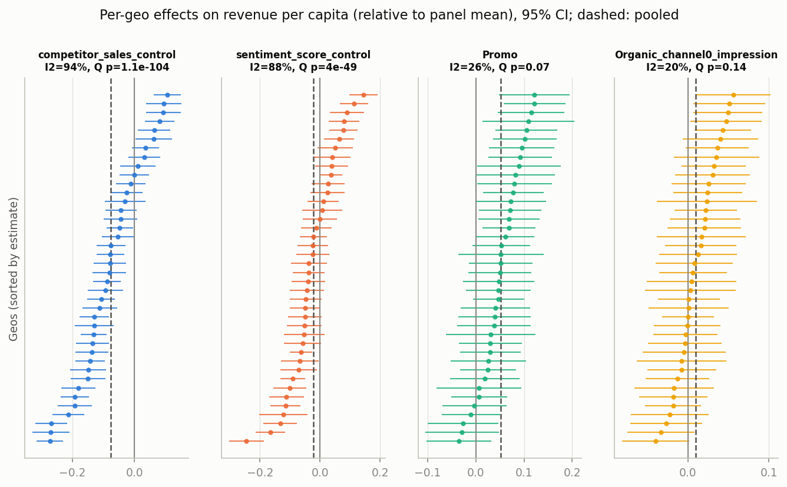

# What the data say (exploratory analysis)

This page summarises what we learned about the data before building the model, and how each finding shaped a modelling choice. Every number is generated by `make eda`. Meridian's own data-check report for the production model is at [model_build/model/eda.html](../model_build/model/eda.html).

## The data are complete and clean
We have 40 regions (geos) observed every week for 156 weeks (2021-01-25 to 2024-01-15). Nothing is missing, nothing is duplicated, and spend, impressions and sales are never negative. The only negative numbers are in the two control indices, which are centred around zero by design.

Revenue per conversion barely changes (it varies by only 0.5%), so results in revenue and in conversions tell the same story.

Channel3 takes the largest share of the budget; Channel2 the smallest:

- Channel0 18.5%, Channel1 14.3%, Channel2 5.5%, Channel3 40.0%, Channel4 21.7%

## Spend and impressions carry the same information
In every channel, spend is exactly impressions times a constant CPM, so it makes no difference whether the model uses spend or impressions. (Meridian's own report flags CPM "outliers"; they are rounding differences, not real.)

Technical details

- Largest deviation from each channel's median CPM: 0.14 parts per million.
- CPM: Channel0 7.33, Channel1 9.64, Channel2 7.43, Channel3 7.79, Channel4 7.79.

## Revenue grows slowly and steadily
National revenue grows by about 1.5% a year, and a straight line describes that growth well: allowing the trend to bend each year does not improve the fit. **For the model:** a straight-line baseline is enough.

Technical details

- Trend: 1.46% of mean revenue per year, p = 0.010 (regression with autocorrelation-robust standard errors; p = 0.007 with a longer window).
- Allowing breaks at weeks 52 and 104 does not improve on a straight line: p = 0.10.
- Last 52 weeks vs first 52 weeks: +2.6%.

## No meaningful yearly seasonality
Revenue shows no repeating yearly pattern beyond what chance would produce. Any seasonal swing is at most about 4% from peak to trough, no larger than ordinary week-to-week noise. **For the model:** no seasonal component is needed.

Technical details

- Week-of-year pattern vs random noise: p = 0.28.
- Fitted yearly wave: peak-to-trough 0.9%, 95% upper bound 4.1%.

## How noisy is revenue week to week?
A typical region's weekly revenue moves up and down by about 30% around its average; nationally, where regions offset each other, by 6.9%. These movements look random: one week tells you almost nothing about the next. **For the model:** this sets the bar for accuracy. Even a simple 13-week average misses a typical regional week by 23% and a national week by 5.1%, so the model cannot be expected to do much better.

Technical details

- Regional variation (CV) ranges from 21.5% to 49.4%.
- Week-to-week correlation: 0.007 (regions, median), -0.025 (national).

## Some weeks move all regions together
Some weeks are up or down in every region at once: these shared weekly movements explain 5.3% of regional revenue variation, against 2.5% expected by chance. Part of this is likely media and the controls, which are also timed nationally, so the data alone cannot tell how much belongs to the baseline. This is why we tested both a flexible and a straight-line baseline when choosing the model.

Technical details

- Permutation test p < 0.001.
- Meridian's automatic knot selection picks 66 of 156 weeks as knots.
- Noise level vs region size: Spearman -0.33; the quietest region's noise is 0.60x the noisiest's.

## Media's effect is hard to see in the raw data
Within each region, weeks with more spend do not clearly have more revenue: every correlation between spend and revenue is tiny (at most 0.08 in size), whether we look at the same week or up to 8 weeks later. That does not mean media has no effect; it means the effect is small relative to the noise, and the model has to pool information across regions to find it. **For the model:** media effects are pooled strongly across regions, and the data do not tell us how long media effects last (we use up to 4 weeks).

Technical details

- Same-week correlations, region averages removed: Channel0 +0.032, Channel1 -0.011, Channel2 -0.050, Channel3 -0.052, Channel4 -0.079; after removing the controls: Channel0 +0.001, Channel1 +0.013, Channel2 +0.014, Channel3 +0.024, Channel4 +0.011.
- Range expected from pure chance: +/-0.025.

## Channels are not too entangled
Channels are switched on and off at fairly different times, so the model can tell them apart. The strongest overlap between two channels is a correlation of 0.50 within regions.

Technical details

- Largest within-region correlation 0.50; national 0.70; variance inflation factor at most 2.11 (values above 5-10 would be a concern).

## Bigger regions have proportionally bigger revenue and spend
Revenue and spend grow in step with population: double the population, roughly double the revenue. **For the model:** revenue and media are expressed per person, which is Meridian's default.

Technical details

- Revenue vs population: Spearman 0.978, log-log slope 1.04 (+/- 0.03); spend 0.995, slope 1.02 (+/- 0.01).
- Control averages barely track population (Spearman competitor_sales_control -0.05, sentiment_score_control +0.23, Promo +0.18), so the controls are not scaled by population.

## How much room there is to spend more
Most weeks run well below each region's highest-ever spend, and some channels are often off (Channel2 is off in 64% of region-weeks). **For budget scenarios:** raising last year's spend by 20% stays within past levels in almost all region-weeks; by 50%, some channels go beyond anything observed, where results rely on the assumed shape of the response curve.

Technical details

- Share of region-weeks with zero spend: Channel0 12.1%, Channel1 27.9%, Channel2 64.3%, Channel3 2.7%, Channel4 13.1%.
- Share of last-52-week region-weeks above the region's historical maximum if spend is raised 20%: Channel0 3.2%, Channel1 1.9%, Channel2 1.4%, Channel3 2.6%, Channel4 2.2%; raised 50%: Channel0 10.4%, Channel1 5.8%, Channel2 3.4%, Channel3 10.3%, Channel4 7.1%.

## The controls must stay in the model
Competitor sales move with both revenue (down when competitors are up) and with our own spend (up to 0.55 correlation). Leaving them out would make media look less effective than it is. Once they are accounted for, the odd negative link between same-week spend and revenue disappears. **For the model:** both controls are included.

Technical details

- Correlation with revenue (within regions): competitor_sales_control -0.20, sentiment_score_control -0.03, Promo +0.13, Organic_channel0_impression +0.03.
- Competitor sales vs each channel's spend: Channel0 +0.07, Channel1 +0.18, Channel2 +0.44, Channel3 +0.50, Channel4 +0.55.

## Control effects differ a lot between regions
How much competitor sales and sentiment move revenue varies strongly from region to region (about 94% and 88% of the variation in their estimated effects is real, not noise). Promo and organic media behave much more consistently. **For the model:** control effects are allowed to vary by region.

Technical details

- Per geo: y ~ const + linear trend + controls + Promo + organic/geo-mean + each spend/geo-mean; Newey-West SEs. Primary y = revenue per capita / panel-mean revenue per capita; sensitivity y = revenue / geo-mean revenue.
- competitor_sales_control: average effect -0.077; share of variation that is real (I2) 93.7% (Cochran's Q = 615.1, p = 1.1e-104); 22% of regions positive.
- sentiment_score_control: average effect -0.021; share of variation that is real (I2) 88.4% (Cochran's Q = 337.1, p = 4e-49); 35% of regions positive.
- Promo: average effect +0.051; share of variation that is real (I2) 26.0% (Cochran's Q = 52.7, p = 0.07); 88% of regions positive.
- Organic_channel0_impression: average effect +0.010; share of variation that is real (I2) 20.1% (Cochran's Q = 48.8, p = 0.14); 65% of regions positive.

