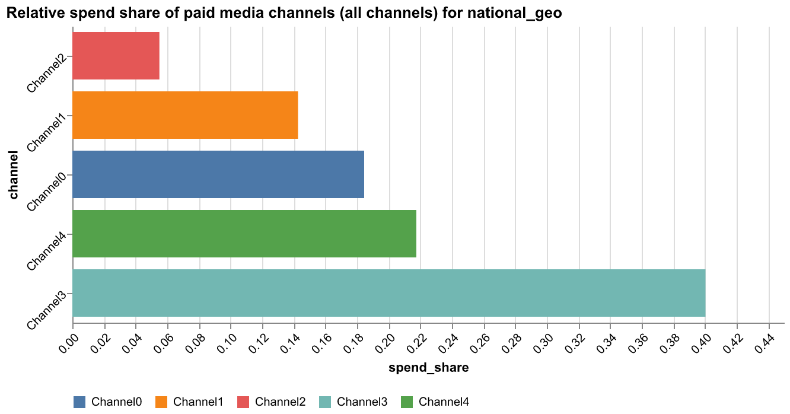
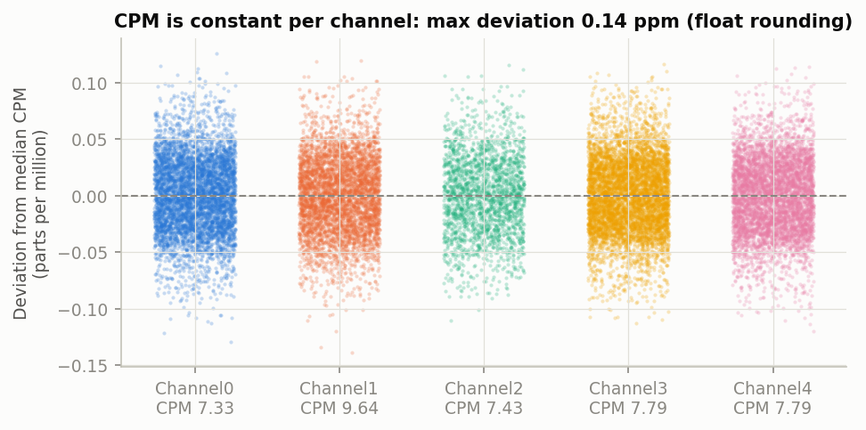
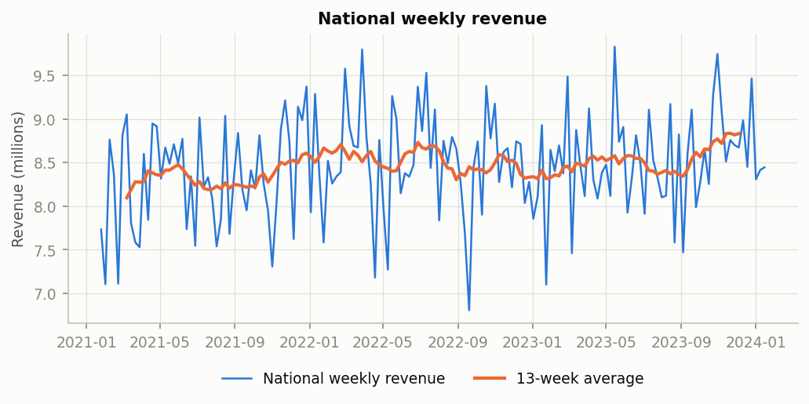
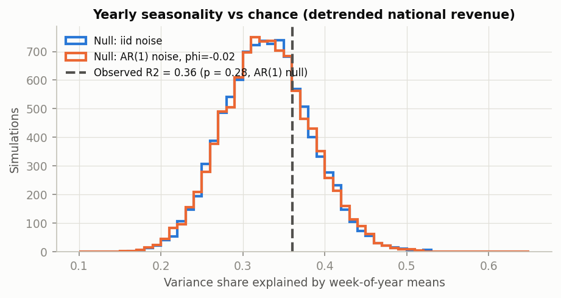
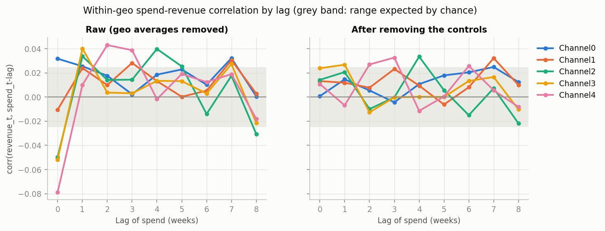
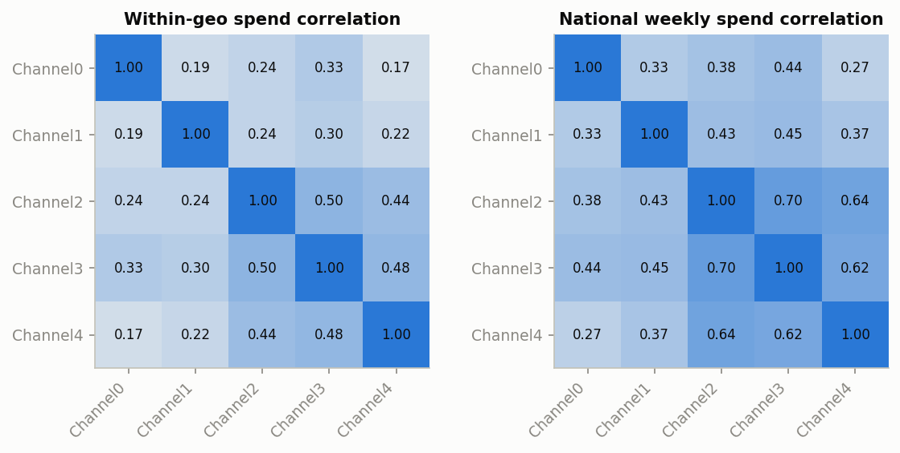
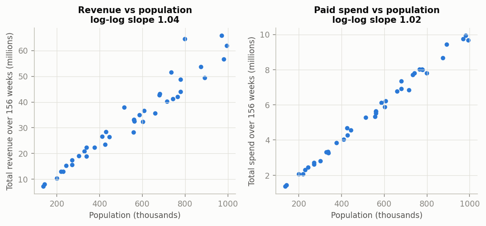
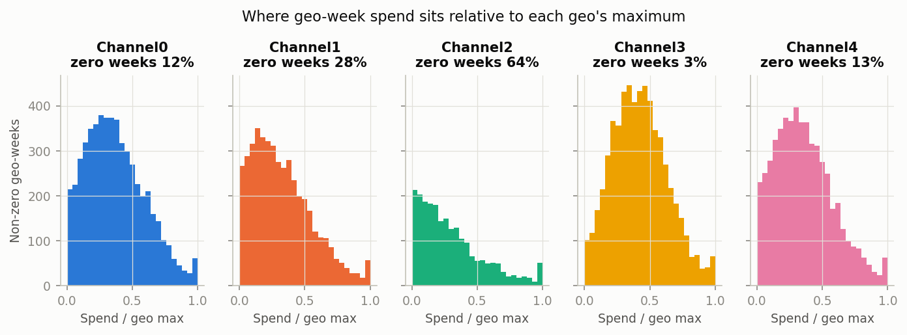
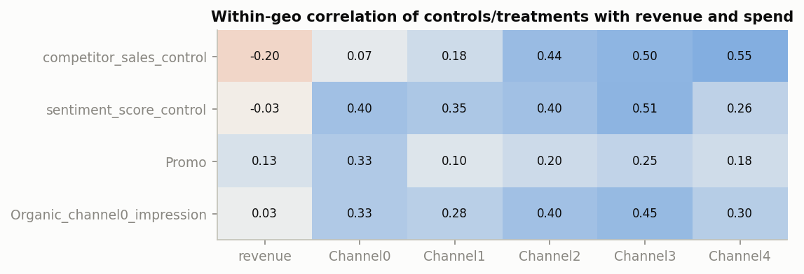

# What the data say (exploratory analysis)

This page summarises what we learned about the data before building the model, and how each finding shaped a modelling choice. Every number is generated by `make eda`.

## The data are complete and clean
We have 40 regions (geos) observed every week for 156 weeks (2021-01-25 to 2024-01-15). Nothing is missing, nothing is duplicated, and spend, impressions and sales are never negative. The only negative numbers are in the two control indices, which are centred around zero by design.

Revenue per conversion barely changes (it varies by only 0.5%), so results in revenue and in conversions tell the same story. Its value (about 0.02) looks low because the simulated conversions are inflated (around 19 per person per week); revenue itself is on a realistic scale, with paid spend at 17% of revenue. Conversions and revenue per conversion should not be read literally, which is one reason results are reported in revenue.

Technical details

- 40 geos x 156 weeks, 6240 rows, weekly steps of 7 days; balanced panel: True; duplicates: 0; missing values: 0.
- Negative values only in the centred controls (competitor_sales_control: 3238, sentiment_score_control: 3216); spend, impressions, KPI, population and revenue per conversion all non-negative: True.
- Revenue per conversion: mean 0.0200, CV 0.5%, range 0.0197-0.0204.
- Total spend 219.5M over 156 weeks; last 52 weeks 71.4M.

Channel3 takes the largest share of the budget; Channel2 the smallest:

- Channel0 18.5%, Channel1 14.3%, Channel2 5.5%, Channel3 40.0%, Channel4 21.7%

## Spend and impressions carry the same information
In every channel, spend is exactly impressions times a constant CPM, so it makes no difference whether the model uses spend or impressions. Any apparent CPM variation is rounding, not real.

Technical details

- Largest deviation from each channel's median CPM: 0.14 parts per million.
- CPM: Channel0 7.33, Channel1 9.64, Channel2 7.43, Channel3 7.79, Channel4 7.79.

## Revenue grows slowly and steadily
National revenue grows by about 1.5% a year, and a straight line describes that growth well: allowing the trend to bend each year does not improve the fit. **For the model:** a straight-line baseline is enough.

Technical details

- Trend: 1.46% of mean revenue per year, p = 0.010 (regression with autocorrelation-robust standard errors).
- Allowing breaks at weeks 52 and 104 does not improve on a straight line: p = 0.10.
- Last 52 weeks vs first 52 weeks: +2.6%.

## No yearly seasonality
We checked whether the same week looks similar every year (for example, a peak every summer). It does not, beyond what chance would produce: random noise of the same length shows a pattern at least this strong 28% of the time. **For the model:** no seasonal component is needed.

Technical details

- Week-of-year means explain R2 = 0.360 of detrended national revenue. Pure noise of the same length gives 0.330 on average (95th percentile 0.418); p = 0.28 (iid null), 0.28 (AR(1) null, phi = -0.025).
- Per region, 6 of 40 regions are significant at 5% (2 expected by chance).

## How noisy is revenue week to week?
A typical region's weekly revenue moves up and down by about 30% around its average; nationally, where regions offset each other, by 6.9%. These movements look random: one week tells you almost nothing about the next. **For the model:** this sets the bar for accuracy. Even a simple 13-week average misses a typical regional week by 23% and a national week by 5.1%, so the model cannot be expected to do much better.

Technical details

- Regional weekly revenue: CV median 30.0% (range 21.5%-49.4%); lag-1 autocorrelation of detrended revenue median 0.007; MAPE of a 13-week moving average 23.1%.
- National weekly revenue: CV 6.9%, lag-1 autocorrelation -0.025, MAPE of a 13-week moving average 5.1%.
- Noise vs region size: Spearman -0.33 between per-capita revenue noise and population; the quietest region's noise is 0.60x the noisiest's. The model uses one noise level for all regions.

## Media's effect is hard to see in the raw data
Within each region, weeks with more spend do not clearly have more revenue: every correlation between spend and revenue is tiny (at most 0.08 in size), whether we look at the same week or up to 8 weeks later. That does not mean media has no effect; it means the effect is small relative to the noise, and the model has to pool information across regions to find it. **For the model:** media effects are pooled strongly across regions, and the data do not tell us how long media effects last (we use up to 4 weeks).

Technical details

- All within-region correlations are small (|r| <= 0.079; 95% band under zero correlation +/-0.025).
- Same-week correlations with region averages removed: Channel0 +0.032, Channel1 -0.011, Channel2 -0.050, Channel3 -0.052, Channel4 -0.079; after removing the controls, Promo and organic: Channel0 +0.001, Channel1 +0.013, Channel2 +0.014, Channel3 +0.024, Channel4 +0.011. The negative raw same-week correlations come from the controls.
- Lags (weeks) where the control-adjusted correlation is above the noise band: Channel0 [7]; Channel1 [7]; Channel2 [4]; Channel3 [1]; Channel4 [2, 3, 6]. No clear decay pattern, so the data do not settle the maximum lag.

## Channels are not too entangled
Channels are switched on and off at fairly different times, so the model can tell them apart. The strongest overlap between two channels is a correlation of 0.50 within regions.

Technical details

- Within-region spend correlation: max |r| = 0.50. Within-region variance inflation factor (spend, Promo, organic, controls) at most 2.11 (values above 5-10 would be a concern).

## Bigger regions have proportionally bigger revenue and spend
Revenue and spend grow in step with population: double the population, roughly double the revenue. **For the model:** revenue and media are expressed per person.

Technical details

- Total revenue vs population: Spearman 0.978, log-log slope 1.04 +/- 0.03; total spend: Spearman 0.995, slope 1.02 +/- 0.01.
- Revenue per capita varies across regions by 10.0% (CV); spend per capita by 3.6%.
- Control averages barely track population (Spearman competitor_sales_control -0.05, sentiment_score_control +0.23, Promo +0.18), so the controls are not scaled by population.

## How much room there is to spend more
Most weeks run well below each region's highest-ever spend, and some channels are often off (Channel2 is off in 64% of region-weeks). **For budget scenarios:** raising last year's spend by 20% stays within past levels in almost all region-weeks; by 50%, some channels go beyond anything observed, where results rely on the assumed shape of the response curve.

Technical details

- Share of region-weeks with zero spend: Channel0 12.1%, Channel1 27.9%, Channel2 64.3%, Channel3 2.7%, Channel4 13.1%.
- Median non-zero week as a share of the region's maximum: Channel0 0.35, Channel1 0.29, Channel2 0.24, Channel3 0.41, Channel4 0.34.
- Share of last-52-week region-weeks above the region's historical maximum if spend is raised 20%: Channel0 3.2%, Channel1 1.9%, Channel2 1.4%, Channel3 2.6%, Channel4 2.2%; raised 50%: Channel0 10.4%, Channel1 5.8%, Channel2 3.4%, Channel3 10.3%, Channel4 7.1%.

## The controls must stay in the model
Competitor sales move with both revenue (down when competitors are up) and with our own spend (up to 0.55 correlation). Leaving them out would make media look less effective than it is. Once they are accounted for, the odd negative link between same-week spend and revenue disappears. **For the model:** both controls are included.

Technical details

- Correlation with revenue (within regions): competitor_sales_control -0.20, sentiment_score_control -0.03, Promo +0.13, Organic_channel0_impression +0.03.
- Competitor sales vs each channel's spend: Channel0 +0.07, Channel1 +0.18, Channel2 +0.44, Channel3 +0.50, Channel4 +0.55.

