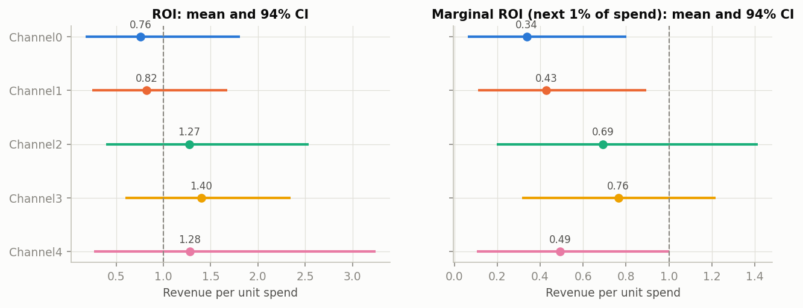
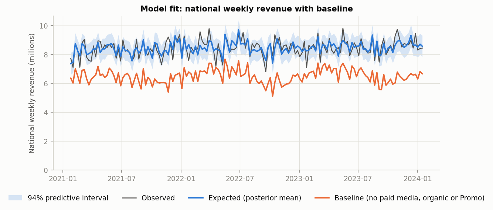
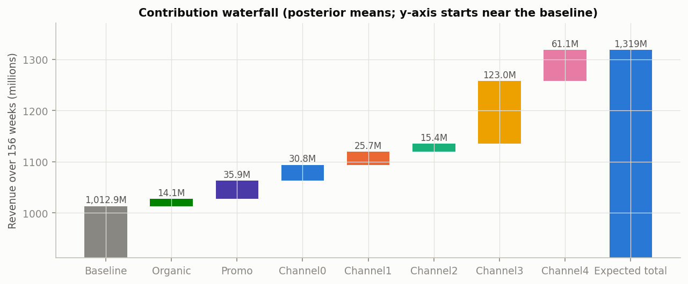
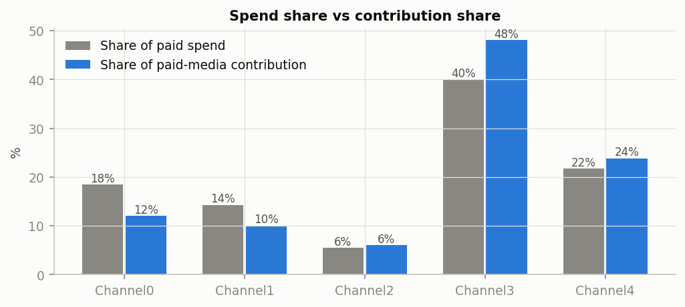
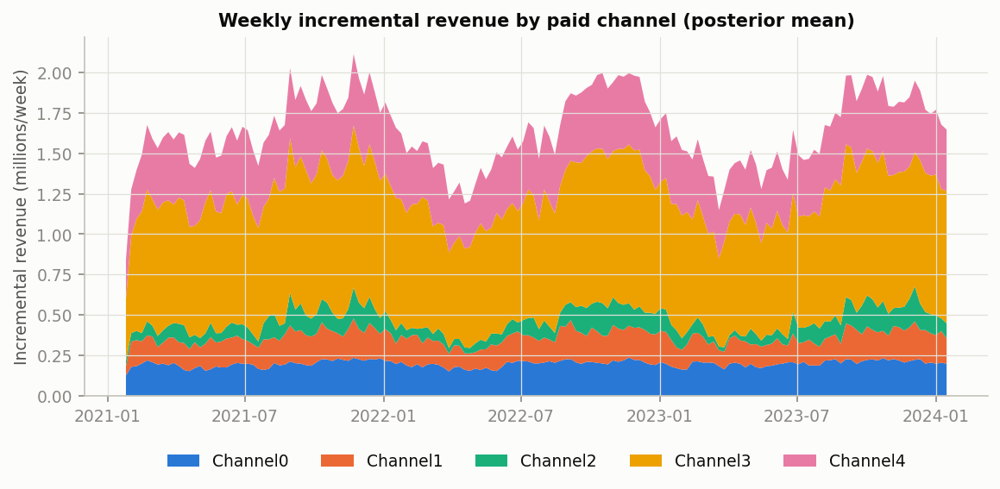
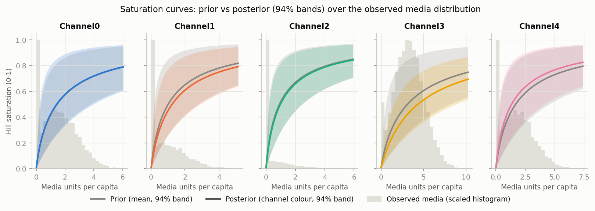
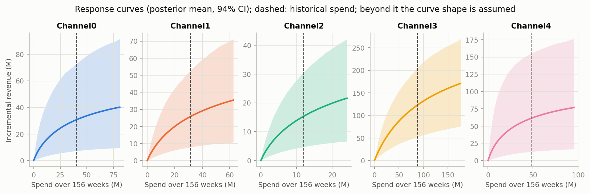
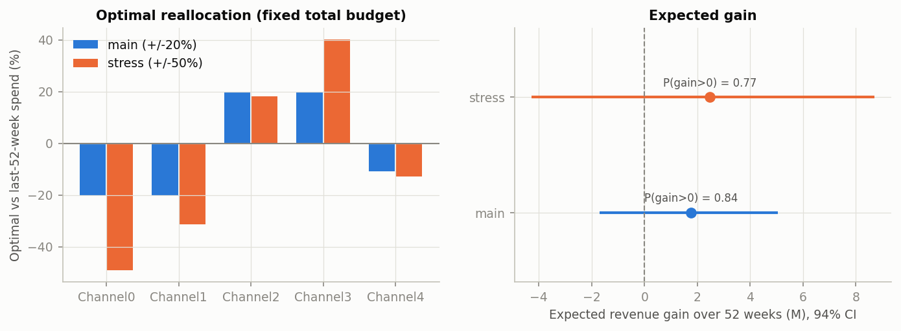
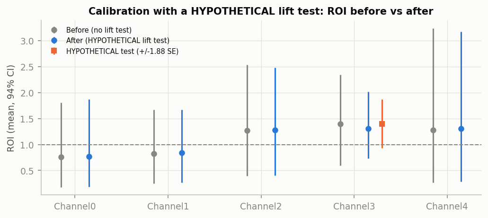

# Measurement: results

National channel results for the selected model over all 156 weeks (2021-01-25 to 2024-01-15). Revenue = conversions x revenue per conversion. Health and caveats: [diagnostics.md](diagnostics.md). Meridian's native reports: [Model Results Summary](meridian/results_summary.html), budget optimization [main](meridian/optimization_main.html) and [stress](meridian/optimization_stress.html). Machine-readable: `outputs/results/channel_results.csv` (+ `_metadata.json`).

## Channel results

For each channel: what it contributed, its ROI (revenue returned per unit of spend) and marginal ROI (return on the next unit of spend), with 94% ranges. P(ROI > 1) is the probability that the channel pays for itself.

| channel | spend | spend share | contribution (94% CI) | share of revenue | ROI (94% CI) | mROI (94% CI) | P(ROI>1) | gate |
|---|---|---|---|---|---|---|---|---|
| Channel0 | 40.5M | 18.5% | 30.8M (7.3M-73.3M) | 2.3% | 0.76 (0.18-1.81) | 0.34 (0.06-0.80) | 0.24 | WARN |
| Channel1 | 31.3M | 14.3% | 25.7M (7.8M-52.5M) | 1.9% | 0.82 (0.25-1.67) | 0.43 (0.11-0.90) | 0.27 | WARN |
| Channel2 | 12.1M | 5.5% | 15.4M (4.7M-30.6M) | 1.2% | 1.27 (0.39-2.54) | 0.69 (0.20-1.41) | 0.64 | WARN |
| Channel3 | 87.9M | 40.0% | 123.0M (52.3M-205.9M) | 9.3% | 1.40 (0.60-2.34) | 0.76 (0.32-1.22) | 0.81 | WARN |
| Channel4 | 47.7M | 21.7% | 61.1M (12.7M-154.8M) | 4.6% | 1.28 (0.27-3.24) | 0.49 (0.10-1.00) | 0.57 | WARN |

- Paid media drove 255.9M of revenue (94% CI 177.4M-364.1M), 19.4% of the 1,318.7M observed; the baseline 1,012.9M.
- Highest mean ROI: Channel3 (1.40) and Channel4 (1.28); lowest: Channel0 (0.76). All intervals are wide and every channel's P(ROI > 1) lies between 0.1 and 0.9, so no channel's payback is determined.
- Marginal ROI is below ROI for every channel (diminishing returns); Channel0 0.34, Channel1 0.43, Channel2 0.69, Channel3 0.76, Channel4 0.49.
- Cost per incremental KPI is not reported because the outcome is modelled in revenue.

## Model fit and baseline

The model's weekly revenue against the actual, and the baseline: what revenue would have been with no media, promotion or organic activity.

## Where revenue comes from

Total revenue broken down into the baseline and each driver's contribution.

## Spend share vs contribution share

Channels whose contribution share exceeds their spend share are doing more than their budget would suggest.
- Channels whose share of paid-media contribution exceeds their spend share: Channel2, Channel3, Channel4.

## Weekly contribution by channel

How much revenue each channel drove, week by week.

## Diminishing returns (saturation curves)

How each channel's effect flattens as its activity grows, before (grey) and after (colour) seeing the data, over the range of activity actually observed.

## Revenue vs spend (response curves)

How much revenue each channel would drive at different spend levels. Beyond the dashed line (historical spend) the curve is an assumption, not an observation.

## Budget scenarios

How to split the same total budget to get more revenue, allowing each channel to move up to 20% (main) or 50% (stress).
Fixed total budget equal to the last 52 weeks' spend (71.4M), optimized over 2023-01-23 to 2024-01-15. The gain is incremental revenue at the optimal allocation minus at the historical allocation, computed per posterior draw.

| scenario | constraint | budget (52 wk) | change vs last 52 weeks | gain (94% CI) | P(gain>0) | budget diff |
|---|---|---|---|---|---|---|
| main | +/-20% | 71.4M | Channel0 -20%, Channel1 -20%, Channel2 +20%, Channel3 +20%, Channel4 -11% | 1.8M (-1.7M to 5.1M) | 0.84 | 0.002% |
| stress | +/-50% | 71.4M | Channel0 -49%, Channel1 -31%, Channel2 +18%, Channel3 +40%, Channel4 -13% | 2.5M (-4.3M to 8.7M) | 0.77 | 0.002% |

- Main (+/-20%): shift spend toward Channel2, Channel3; expected gain 1.8M (2.1% of media-driven revenue) with P(gain > 0) = 0.84. The interval includes losses: the reallocation is more likely than not to help, and the size of the gain is uncertain.
- Stress (+/-50%): larger shifts, expected gain 2.5M with P(gain > 0) = 0.77; wider interval.
- Budget is conserved in both scenarios (difference = the optimizer's rounding of the budget to its spend grid).
- Beyond historically observed spend, results assume the response-curve shape. Scaling the last 52 weeks by 1.5 would push Channel0 10%, Channel1 6%, Channel2 3%, Channel3 10%, Channel4 7% of geo-weeks above each geo's historical maximum.

## Using a lift test (HYPOTHETICAL)

How a real experiment would sharpen the model. The test here is invented, to show the method.
**HYPOTHETICAL** test (`data/lift_tests/lift_tests.csv`, schema in `data/lift_tests/README.md`): Channel3, 2023-07-03 to 2023-08-27, 10 test geos, ROI 1.4 (SE 0.25). It was fed to Meridian's `CalibrationBuilder` (baseline prior LogNormal(0.2, 0.9), geometric decay, max lag 4). The resulting Channel3 ROI prior has mean 1.23 and sd 0.47: the spend adjustment widens the test's uncertainty because the test covered a fraction of the channel's national spend. The calibrated refit converged (max R-hat 1.0092, min bulk ESS 607, 0 divergences).

| channel | ROI before (94% CI) | P(ROI>1) before | ROI after (94% CI) | P(ROI>1) after |
|---|---|---|---|---|
| Channel0 | 0.76 (0.18-1.81) | 0.24 | 0.77 (0.19-1.88) | 0.25 |
| Channel1 | 0.82 (0.25-1.67) | 0.27 | 0.84 (0.27-1.68) | 0.28 |
| Channel2 | 1.27 (0.39-2.54) | 0.64 | 1.27 (0.40-2.48) | 0.66 |
| Channel3 | 1.40 (0.60-2.34) | 0.81 | 1.30 (0.73-2.01) | 0.81 |
| Channel4 | 1.28 (0.27-3.24) | 0.57 | 1.31 (0.28-3.17) | 0.59 |

- Model vs test: for the test geos and weeks, the uncalibrated model implied Channel3 ROI 1.43 (94% CI 0.62-2.40); the HYPOTHETICAL test said 1.4. After calibration the model implies 1.33.
- Test-geo choice: across 20 alternative stratified sets of the same size, the model-implied ROI ranges 1.35-1.50 (chosen set at the 35% percentile) and the calibrated prior mean 1.20-1.21. The choice of test geos does not drive the result.
- The test value equals the uncalibrated national ROI estimate to two decimals by coincidence (it was fixed before that estimate was computed), so calibration narrows the interval more than it moves the mean.

## Caveats

Read these before sharing any number from this page.
- Read [diagnostics.md](diagnostics.md) first: out-of-sample validation is thin, and the candidate set and convergence criteria were revised after earlier rounds failed to converge.
- Baseline and media trade off almost one-for-one; totals are firmer than channel splits.
- National results only; no geo-level ROI.
- The lift test is HYPOTHETICAL; calibrated numbers illustrate the method, not real evidence.
