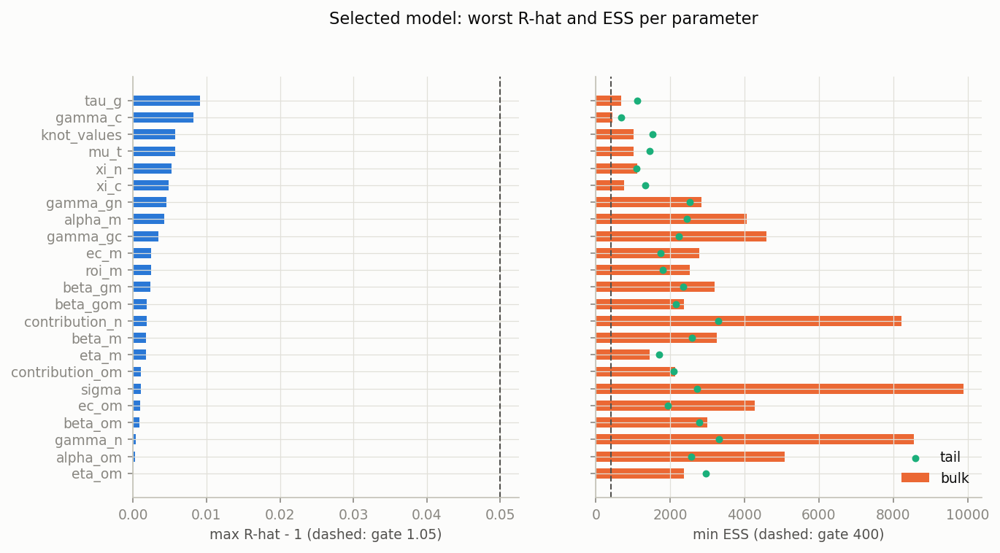
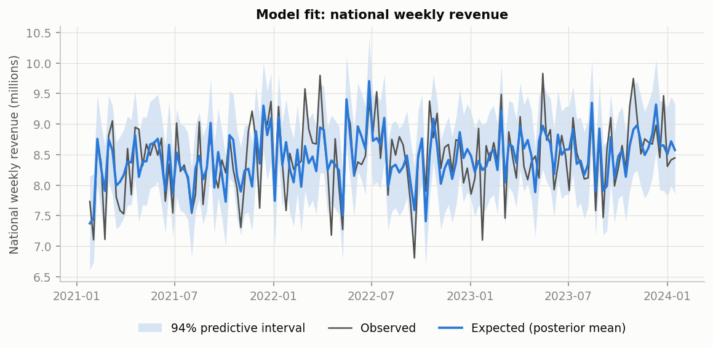
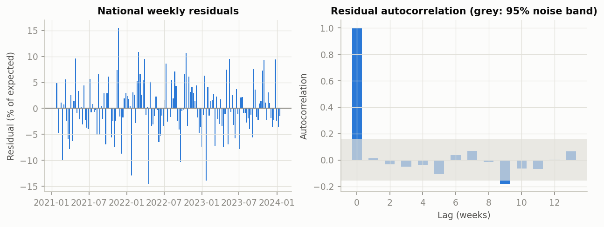
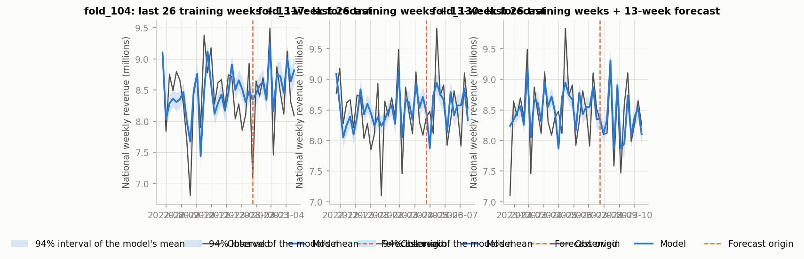
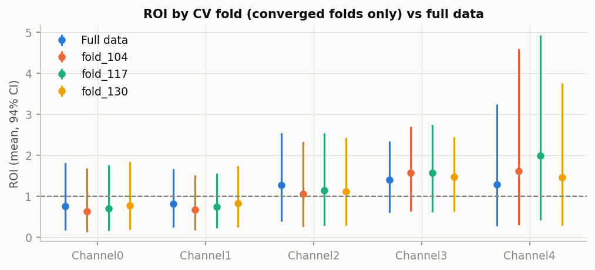
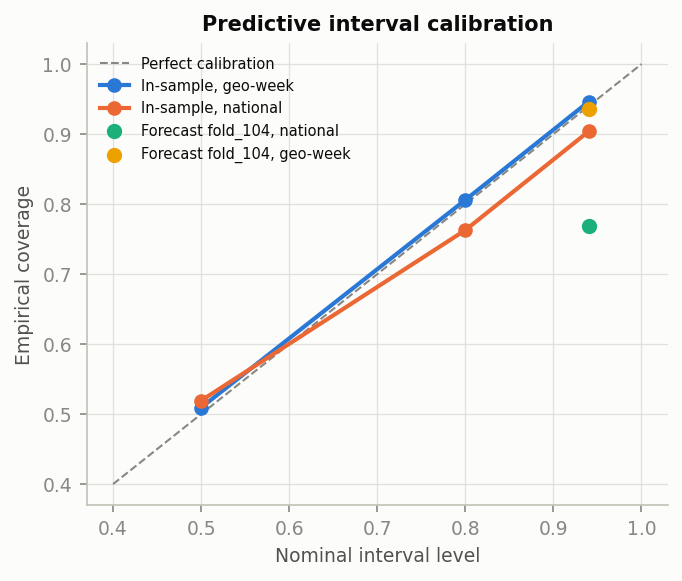
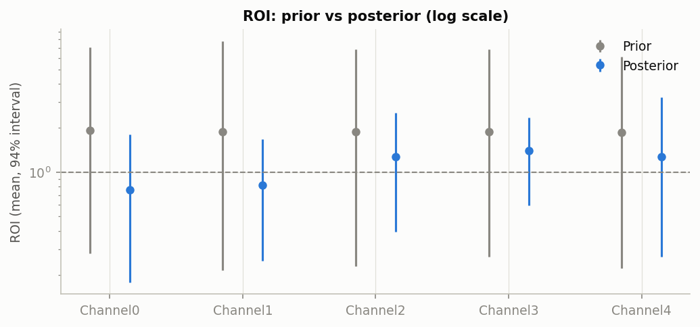

# Results

This report has three parts: **diagnostics** (can we trust the model?), **measurement** (what does it say?) and the **acceptance gates** (the rules the model must pass). What we learned about the data before modelling is in [eda.md](eda.md); the model itself is defined in [`config/model.toml`](../config/model.toml).

# Part 1: Diagnostics

Production model (`config/model.toml`): Geo-level Meridian MMM: straight-line baseline (knots = 2, one knot at each end), media effects strongly pooled across geos (eta_m ~ HalfNormal(0.1)), geometric adstock with max lag 4, ROI priors LogNormal(0.2, 0.9) on all paid channels.

Meridian's native reports: [health check](meridian/health_check.html), [Model Results Summary](meridian/results_summary.html).

## Why this model

We run one model. Here is why it looks the way it does.

The model's choices follow from what the EDA could and could not settle, and from what sampled reliably on this data in earlier attempts:

- **Straight-line baseline** (`knots = 2`): the trend is linear and there is no yearly seasonality.
- **Media effects strongly pooled across geos:** each geo's own media signal is too weak to estimate a separate effect.
- **Max lag 4:** the data do not say how long media effects last, and shorter lags sample more reliably.
- In our first attempts, a more flexible baseline (Meridian's automatic knot selection) and looser pooling did not sample reliably on this data.
- We loosened the reliability criteria after the first attempts failed to meet them; the original, stricter criteria are recorded in config/gates.toml.

## Are the inputs and starting assumptions sound?

The data are checked for completeness, and the model's starting assumptions are checked for whether they can produce numbers like the real ones. Result: data PASS, starting assumptions PASS.

- Data integrity: PASS (checksum, balanced 40 x 156 panel, no missing or duplicate rows, non-negative spend/impressions/KPI). Details in [eda.md](eda.md).
- Prior predictive: 100% of national weeks lie in the prior predictive 94% interval (PASS); the interval is wide (prior predictive 94% interval width / observed mean: 7.06), so this only rules out priors that cannot produce the data.

## Did the computation run reliably? (convergence)

Meridian estimates the model by running 4 independent simulations. If they agree, the results can be trusted; if not, we report nothing. Result: PASS.

- Gate: R-hat <= 1.05, bulk and tail ESS >= 400, at most 20 divergent draws of 4000.
- Selected model: max R-hat 1.0091, min bulk ESS 441, min tail ESS 690, 1 divergence(s): PASS.

## How well does the model fit the past?

Judged against how noisy weekly revenue is: does it explain enough, are its misses random, and do its uncertainty ranges contain about the right share of past weeks? Result: fit PASS, ranges PASS, misses PASS.

- R2: geo-week 0.767, national weekly 0.476; MAPE: geo-week 26.0%, national 4.0% (noise floor: a 13-week moving average has MAPE 23.1% per geo, 5.1% nationally).
- 94% interval coverage: geo-week 94.6%, national 90.4% (PASS). Within-geo R2 0.274 (PASS); residual lag-1 autocorrelation: national +0.011, median geo +0.001 (PASS).

## Can it forecast weeks it has not seen? (holdout and CV)

This is the most important check. We refit the model on shorter stretches of history and see how well it predicts the next 13 weeks. Only 1 of 4 refits ran reliably, so this check fails: we cannot yet vouch for the model's forecasts.

Folds train on weeks 1-104, 1-117, 1-130 and 1-143 (the last is the 13-week holdout) and forecast the next 13 weeks. Each fold is refitted on the truncated data, so all scaling is computed inside the fold. Forecasts use Meridian's equations with the linear baseline extended, conditional on observed media, controls, Promo and organic.

Findings:
- 1 of 4 fold fits passed the convergence gate; fold_117, fold_130, holdout did not, so they report diagnostics only.
- fold_104: geo-week forecast MAPE 26.6% vs in-sample 25.6% (ratio 1.04, gate <= 1.25); national MAPE 4.5% (gate <= 10%), ratio 1.09.
- fold_104: 94% interval coverage 94% at geo-week level but 77% nationally (gate >= 80%). The national forecast is biased by +3.1% on average and over-predicts in 54% of forecast weeks. Summing geos makes the national interval narrow relative to a shared bias, so a few percent of bias is enough to push national weeks outside it while geo-week intervals, dominated by geo-level noise, still cover.

| fold | train weeks | converged | geo MAPE | geo ratio | geo cov. | nat. MAPE | nat. ratio | nat. cov. | nat. bias | gate |
|---|---|---|---|---|---|---|---|---|---|---|
| fold_104 | 1-104 | yes | 26.6% | 1.04 | 94% | 4.5% | 1.09 | 77% | +3.1% | FAIL |
| fold_117 | 1-117 | no | - | - | - | - | - | - | - | FAIL |
| fold_130 | 1-130 | no | - | - | - | - | - | - | - | FAIL |
| holdout | 1-143 | no | - | - | - | - | - | - | - | FAIL |

ROI stability across folds: FAIL (Not assessable: fewer than two converged fold fits.).

## Can the model tell media apart from everything else?

Partly. The data clearly moved every channel's estimate away from the starting assumption, but the model struggles to split revenue between media and underlying demand.

- ROI contraction (1 - posterior sd / prior sd): Channel0 0.78, Channel1 0.83, Channel2 0.68, Channel3 0.77, Channel4 0.61 (warn below 0.3): the data move every channel's ROI away from the prior.
- Baseline vs media: across posterior draws, total baseline and total paid-media contribution have correlation -0.97. The model pins down their sum precisely but not the split between them; this is the main source of ROI uncertainty.

## Meridian's own health checks

Meridian's built-in checks all pass, but they are more lenient than ours and only look at the past.

Overall: PASS, health score 93.1/100. Where Meridian's thresholds are looser than our gates:

| check | status | comparison with our gates |
|---|---|---|
| Convergence | PASS | Meridian passes R-hat < 1.2; our gate uses R-hat <= 1.05 plus ESS and divergences |
| Baseline | PASS |  |
| BayesianPPP | PASS | Meridian checks only the total outcome; our gate checks weekly interval coverage |
| GoodnessOfFit | PASS | Meridian reports R2/MAPE for guidance only (no pass/fail bar); our in-sample and CV gates are explicit |
| PriorPosteriorShift | PASS |  |
| ImplausibleROI | PASS |  |
| HighVariance | PASS |  |
| PotentialBias | PASS |  |

## Known limitations

What a reader should keep in mind.

- Out-of-sample evidence is thin: only one CV fold fit converged, and its national interval coverage misses the gate.
- Sampling is fragile: the selected model converges on the full data but not reliably on shorter windows.
- Baseline and media trade off almost one-for-one, so channel ROIs are wide and no channel's payback is determined (P(ROI > 1) between 0.1 and 0.9 for every channel).
- The linear-trend baseline cannot absorb week-level shocks common to all geos; the EDA found some common weekly variation beyond noise.

# Part 2: Measurement

National channel results for the model over all 156 weeks (2021-01-25 to 2024-01-15). Revenue = conversions x revenue per conversion. Health and caveats: Part 1. Meridian's native reports: [Model Results Summary](meridian/results_summary.html), budget optimization [main](meridian/optimization_main.html) and [stress](meridian/optimization_stress.html). Machine-readable: `outputs/results/channel_results.csv` (+ `_metadata.json`).

## Channel results

For each channel: what it contributed, its ROI (revenue returned per unit of spend) and marginal ROI (return on the next unit of spend), with 94% ranges. P(ROI > 1) is the probability that the channel pays for itself.

| channel | spend | spend share | contribution (94% CI) | share of revenue | ROI (94% CI) | mROI (94% CI) | P(ROI>1) | gate |
|---|---|---|---|---|---|---|---|---|
| Channel0 | 40.5M | 18.5% | 30.8M (7.3M-73.3M) | 2.3% | 0.76 (0.18-1.81) | 0.34 (0.06-0.80) | 0.24 | WARN |
| Channel1 | 31.3M | 14.3% | 25.7M (7.8M-52.5M) | 1.9% | 0.82 (0.25-1.67) | 0.43 (0.11-0.90) | 0.27 | WARN |
| Channel2 | 12.1M | 5.5% | 15.4M (4.7M-30.6M) | 1.2% | 1.27 (0.39-2.54) | 0.69 (0.20-1.41) | 0.64 | WARN |
| Channel3 | 87.9M | 40.0% | 123.0M (52.3M-205.9M) | 9.3% | 1.40 (0.60-2.34) | 0.76 (0.32-1.22) | 0.81 | WARN |
| Channel4 | 47.7M | 21.7% | 61.1M (12.7M-154.8M) | 4.6% | 1.28 (0.27-3.24) | 0.49 (0.10-1.00) | 0.57 | WARN |

- Paid media drove 255.9M of revenue (94% CI 177.4M-364.1M), 19.4% of the 1,318.7M observed; the baseline 1,012.9M.
- Highest mean ROI: Channel3 (1.40) and Channel4 (1.28); lowest: Channel0 (0.76). All intervals are wide and every channel's P(ROI > 1) lies between 0.1 and 0.9, so no channel's payback is determined.
- Marginal ROI is below ROI for every channel (diminishing returns); Channel0 0.34, Channel1 0.43, Channel2 0.69, Channel3 0.76, Channel4 0.49.
- Cost per incremental KPI is not reported because the outcome is modelled in revenue.

## Model fit and baseline

The model's weekly revenue against the actual, and the baseline: what revenue would have been with no media, promotion or organic activity.

## Where revenue comes from

Total revenue broken down into the baseline and each driver's contribution.

## Spend share vs contribution share

Channels whose contribution share exceeds their spend share are doing more than their budget would suggest.

- Channels whose share of paid-media contribution exceeds their spend share: Channel2, Channel3, Channel4.

## Weekly contribution by channel

How much revenue each channel drove, week by week.

## Diminishing returns (saturation curves)

How each channel's effect flattens as its activity grows, before (grey) and after (colour) seeing the data, over the range of activity actually observed.

## Revenue vs spend (response curves)

How much revenue each channel would drive at different spend levels. Beyond the dashed line (historical spend) the curve is an assumption, not an observation.

## Budget scenarios

How to split the same total budget to get more revenue, allowing each channel to move up to 20% (main) or 50% (stress).

Fixed total budget equal to the last 52 weeks' spend (71.4M), optimized over 2023-01-23 to 2024-01-15. The gain is incremental revenue at the optimal allocation minus at the historical allocation, computed per posterior draw.

| scenario | constraint | budget (52 wk) | change vs last 52 weeks | gain (94% CI) | P(gain>0) | budget diff |
|---|---|---|---|---|---|---|
| main | +/-20% | 71.4M | Channel0 -20%, Channel1 -20%, Channel2 +20%, Channel3 +20%, Channel4 -11% | 1.8M (-1.7M to 5.1M) | 0.84 | 0.002% |
| stress | +/-50% | 71.4M | Channel0 -49%, Channel1 -31%, Channel2 +18%, Channel3 +40%, Channel4 -13% | 2.5M (-4.3M to 8.7M) | 0.77 | 0.002% |

- Main (+/-20%): shift spend toward Channel2, Channel3; expected gain 1.8M (2.1% of media-driven revenue) with P(gain > 0) = 0.84. The interval includes losses: the reallocation is more likely than not to help, and the size of the gain is uncertain.
- Stress (+/-50%): larger shifts, expected gain 2.5M with P(gain > 0) = 0.77; wider interval.
- Budget is conserved in both scenarios (difference = the optimizer's rounding of the budget to its spend grid).
- Beyond historically observed spend, results assume the response-curve shape. Scaling the last 52 weeks by 1.5 would push Channel0 10%, Channel1 6%, Channel2 3%, Channel3 10%, Channel4 7% of geo-weeks above each geo's historical maximum.

## Using a lift test (HYPOTHETICAL)

How a real experiment would sharpen the model. The test here is invented, to show the method.

**HYPOTHETICAL** test (`data/lift_tests/lift_tests.csv`, schema in `data/lift_tests/README.md`): Channel3, 2023-07-03 to 2023-08-27, 10 test geos, ROI 1.4 (SE 0.25). It was fed to Meridian's `CalibrationBuilder` (baseline prior LogNormal(0.2, 0.9), geometric decay, max lag 4). The resulting Channel3 ROI prior has mean 1.23 and sd 0.47: the spend adjustment widens the test's uncertainty because the test covered a fraction of the channel's national spend. The calibrated refit converged (max R-hat 1.0092, min bulk ESS 607, 0 divergences).

| channel | ROI before (94% CI) | P(ROI>1) before | ROI after (94% CI) | P(ROI>1) after |
|---|---|---|---|---|
| Channel0 | 0.76 (0.18-1.81) | 0.24 | 0.77 (0.19-1.88) | 0.25 |
| Channel1 | 0.82 (0.25-1.67) | 0.27 | 0.84 (0.27-1.68) | 0.28 |
| Channel2 | 1.27 (0.39-2.54) | 0.64 | 1.27 (0.40-2.48) | 0.66 |
| Channel3 | 1.40 (0.60-2.34) | 0.81 | 1.30 (0.73-2.01) | 0.81 |
| Channel4 | 1.28 (0.27-3.24) | 0.57 | 1.31 (0.28-3.17) | 0.59 |

- Model vs test: for the test geos and weeks, the uncalibrated model implied Channel3 ROI 1.43 (94% CI 0.62-2.40); the HYPOTHETICAL test said 1.4. After calibration the model implies 1.33.
- Test-geo choice: across 20 alternative stratified sets of the same size, the model-implied ROI ranges 1.35-1.50 (chosen set at the 35% percentile) and the calibrated prior mean 1.20-1.21. The choice of test geos does not drive the result.
- The test value equals the uncalibrated national ROI estimate to two decimals by coincidence (it was fixed before that estimate was computed), so calibration narrows the interval more than it moves the mean.

## Caveats

Read these before sharing any number from this page.

- Read Part 1 first: out-of-sample validation is thin, and the candidate set and convergence criteria were revised after earlier attempts failed to converge.
- Baseline and media trade off almost one-for-one; totals are firmer than channel splits.
- National results only; no geo-level ROI.
- The lift test is HYPOTHETICAL; calibrated numbers illustrate the method, not real evidence.

# Part 3: Acceptance gates

These are the checks the model must pass before its numbers go to a client. A **blocking** check that fails means the model is not client-ready; a non-blocking check only adds a caveat. Rules and thresholds live in [`config/gates.toml`](../config/gates.toml), which the scripts read. `make gates` exits non-zero if any blocking gate fails.

- **PASS:** the check meets its threshold. **WARN:** a non-blocking check misses it (report with caveats). **FAIL:** a blocking check misses it (not client-ready).
- Intervals: 94% (3rd-97th percentile of the predictive or posterior draws).
- The candidate set and the convergence criteria were revised after earlier rounds failed to converge; the original convergence gate was R-hat <= 1.01, bulk/tail ESS >= 400 and 0 divergences.

## Gate summary

Blocking failures: cv_fold_104, cv_fold_117, cv_fold_130, cv_holdout, roi_fold_stability.

| gate | the question it answers | blocking | latest status |
|---|---|---|---|
| [data_integrity](#data_integrity) | Is the data file the one we expect, complete and free of impossible values? | yes | data_integrity PASS |
| [prior_predictive_coverage](#prior_predictive_coverage) | Before seeing the data, can the model's starting assumptions produce numbers like the real ones? | yes | prior_predictive_coverage PASS |
| [convergence](#convergence) | Did the computation run reliably? The model is estimated by several independent simulations; they must agree. | yes | convergence PASS |
| [insample_r2](#insample_r2) | Does the model explain a reasonable share of what happened in the past? | yes | insample_r2 PASS |
| [insample_coverage](#insample_coverage) | Do the model's 94% ranges contain about 94% of past weeks, neither too narrow nor too wide? | yes | insample_coverage PASS |
| [within_geo_r2](#within_geo_r2) | Does the model pick up week-to-week movements within each geo, not just the differences between geos? | no (warn only) | within_geo_r2 PASS |
| [residual_autocorrelation](#residual_autocorrelation) | Are the model's misses random, or does it repeatedly miss in the same direction week after week? | no (warn only) | residual_autocorrelation PASS |
| [cv](#cv) | Does the model forecast weeks it has not seen? We refit it on shorter histories and check the next 13 weeks. | yes | cv_fold_104 FAIL, cv_fold_117 FAIL, cv_fold_130 FAIL, cv_holdout FAIL |
| [roi_fold_stability](#roi_fold_stability) | Do the channel ROIs stay roughly the same when the model is refitted on less data? | yes | roi_fold_stability FAIL |
| [channel_roi_checks](#channel_roi_checks) | For each channel: did the data actually inform the ROI, and is it clear whether the channel pays back? | no (warn only) | channel_roi_checks WARN |

## Gate definitions and latest results

### data_integrity

**Is the data file the one we expect, complete and free of impossible values?**

- **Blocking:** yes
- **Applies to:** raw data file
- **Rule:** Raw CSV matches its pinned SHA-256; balanced 40 x 156 geo-week panel; no missing values; no duplicate geo-weeks; spend, impressions, KPI, population and revenue per KPI are non-negative. FAIL if any check is false.
- **Source of threshold:** PROMPT.md
- **Basis:** Hard data checks; any failure means the inputs are not the documented dataset.
- **Enforced in:** `scripts/gates.py (data_integrity), values from scripts/eda.py`

| threshold | value |
|---|---|
| (none) | |

Latest result:

| check | status | value |
|---|---|---|
| data_integrity | PASS | checksum_ok True, balanced_panel True, missing 0, duplicates 0, nonnegative True |

### prior_predictive_coverage

**Before seeing the data, can the model's starting assumptions produce numbers like the real ones?**

- **Blocking:** yes
- **Applies to:** selected model, prior draws
- **Rule:** Share of national weekly revenue observations inside the prior predictive 94% interval. FAIL below the minimum.
- **Source of threshold:** project
- **Basis:** Rules out priors that cannot generate the observed data. A weak check: the prior predictive interval is wide by design, so a PASS says little about prior quality.
- **Enforced in:** `scripts/gates.py`

| threshold | value |
|---|---|
| `prior_predictive_national_coverage_min` | 0.8 |

Latest result:

| check | status | value |
|---|---|---|
| prior_predictive_coverage | PASS | 1 |

Note: prior predictive 94% interval width / observed mean: 7.06

### convergence

**Did the computation run reliably? The model is estimated by several independent simulations; they must agree.**

- **Blocking:** yes
- **Applies to:** every fit: the production model, its CV refits, the optional calibrated refit
- **Rule:** For every element of every posterior variable (elements constant across all draws, such as the baseline geo's intercept, are skipped): max R-hat, min bulk ESS, min tail ESS; and the share of divergent NUTS transitions. FAIL if any threshold is breached. A failing fit records only its convergence diagnostics; its ROI, fit and contributions are never reported.
- **Source of threshold:** project (revised; see meta.note)
- **Basis:** ESS >= 400 bulk and tail follows Vehtari et al. (2021). R-hat <= 1.05 is looser than their 1.01 and stricter than Meridian's own health check (R-hat < 1.2). Up to 0.5% divergent draws (20 of 4000) are tolerated.
- **Enforced in:** `scripts/check_convergence.py (make convergence)`

| threshold | value |
|---|---|
| `rhat_max` | 1.05 |
| `ess_min` | 400 |
| `divergent_share_max` | 0.005 |

Latest result:

| check | status | value |
|---|---|---|
| convergence | PASS | max_rhat 1.009, min_ess_bulk 441.2, min_ess_tail 690, divergences 1 |

Note: R-hat <= 1.05, bulk/tail ESS >= 400, <= 0.5% divergent draws (config/gates.toml). The candidate set and the convergence criteria were revised after earlier rounds failed to converge; the original convergence gate was R-hat <= 1.01, bulk/tail ESS >= 400 and 0 divergences.

### insample_r2

**Does the model explain a reasonable share of what happened in the past?**

- **Blocking:** yes
- **Applies to:** selected model, all 156 weeks
- **Rule:** R2 of the posterior-mean prediction at geo-week and national weekly level. FAIL if either is below its minimum.
- **Source of threshold:** project
- **Basis:** Geo-week: revenue scales with population, so geo levels dominate the variance; a model must explain at least half of it. National: weekly revenue has CV 6.9% and is close to white noise (lag-1 -0.02), so there is little variance to explain and a modest R2 is the realistic bar.
- **Enforced in:** `scripts/gates.py`

| threshold | value |
|---|---|
| `insample_geo_week_r2_min` | 0.5 |
| `insample_national_r2_min` | 0.25 |

Latest result:

| check | status | value |
|---|---|---|
| insample_r2 | PASS | geo_week 0.7669, national 0.4763 |

### insample_coverage

**Do the model's 94% ranges contain about 94% of past weeks, neither too narrow nor too wide?**

- **Blocking:** yes
- **Applies to:** selected model, all 156 weeks
- **Rule:** Share of observations inside the 94% posterior predictive interval, at geo-week and national level. FAIL outside the range.
- **Source of threshold:** project
- **Basis:** Nominal 94%; 85-99% allows for sampling noise. Below: intervals too narrow; above: too wide.
- **Enforced in:** `scripts/gates.py`

| threshold | value |
|---|---|
| `insample_coverage_range` | [0.85, 0.99] |

Latest result:

| check | status | value |
|---|---|---|
| insample_coverage | PASS | geo_week 0.9463, national 0.9038 |

### within_geo_r2

**Does the model pick up week-to-week movements within each geo, not just the differences between geos?**

- **Blocking:** no (WARN only)
- **Applies to:** selected model
- **Rule:** R2 after removing each geo's mean (week-to-week signal within geos). WARN below the minimum.
- **Source of threshold:** PROMPT.md (as a warning)
- **Basis:** Geo-week revenue has a within-geo CV of 30% and is close to white noise, so most within-geo variance is unexplainable; this flags a model with almost no within-geo signal.
- **Enforced in:** `scripts/gates.py`

| threshold | value |
|---|---|
| `warn_within_geo_r2_min` | 0.1 |

Latest result:

| check | status | value |
|---|---|---|
| within_geo_r2 | PASS | 0.2741 |

### residual_autocorrelation

**Are the model's misses random, or does it repeatedly miss in the same direction week after week?**

- **Blocking:** no (WARN only)
- **Applies to:** selected model
- **Rule:** Lag-1 autocorrelation of residuals: national weekly series and median across geos. WARN if either absolute value exceeds the maximum.
- **Source of threshold:** PROMPT.md (as a warning)
- **Basis:** Revenue itself has lag-1 autocorrelation near 0 (EDA), so residual autocorrelation signals missing time structure.
- **Enforced in:** `scripts/gates.py`

| threshold | value |
|---|---|
| `warn_residual_lag1_abs_max` | 0.2 |

Latest result:

| check | status | value |
|---|---|---|
| residual_autocorrelation | PASS | national_lag1 0.01116, median_geo_lag1 0.0006571 |

### cv

**Does the model forecast weeks it has not seen? We refit it on shorter histories and check the next 13 weeks.**

- **Blocking:** yes
- **Applies to:** holdout (train 1-143, forecast 144-156) and each rolling-origin fold (train 1-104, 1-117, 1-130; forecast the next 13 weeks); reported as cv_fold_104, cv_fold_117, cv_fold_130, cv_holdout
- **Rule:** Each fold is refitted on its training weeks only (all scaling inside the fold). FAIL if the fold fit does not pass the convergence gate (no forecast evidence), or if any of: forecast/in-sample MAPE ratio above the maximum (geo-week or national); national weekly MAPE above the maximum; 94% interval coverage below the minimum (geo-week or national).
- **Source of threshold:** PROMPT.md
- **Basis:** National MAPE: a 13-week moving average has MAPE 5.1% nationally, so 10% is about 1.9x the noise floor; kept at the PROMPT.md value. The error ratio and coverage are relative measures and need no noise-floor adjustment. Geo-week MAPE is not gated directly: its noise floor is 23%.
- **Enforced in:** `scripts/validate_cv.py (metrics), scripts/gates.py (gate)`

| threshold | value |
|---|---|
| `cv_error_ratio_max` | 1.25 |
| `cv_national_mape_max` | 0.1 |
| `cv_coverage_min` | 0.8 |

Latest result:

| check | status | value |
|---|---|---|
| cv_fold_104 | FAIL | geo_error_ratio 1.039, national_error_ratio 1.094, national_mape 0.04463, geo_coverage 0.9365, national_coverage 0.7692, national_bias 0.03119, failed [national_coverage] |
| cv_fold_117 | FAIL | converged False |
| cv_fold_130 | FAIL | converged False |
| cv_holdout | FAIL | converged False |

Note: Fold fit did not converge; no forecast evidence (diagnostics only).

### roi_fold_stability

**Do the channel ROIs stay roughly the same when the model is refitted on less data?**

- **Blocking:** yes
- **Applies to:** converged CV fold fits
- **Rule:** Per channel, max/min of the posterior-mean ROI across converged folds. WARN above the warn ratio, FAIL above the fail ratio. FAIL (not assessable) with fewer than 2 converged folds.
- **Source of threshold:** PROMPT.md
- **Basis:** ROI that changes several-fold when a quarter of data is added is not a stable estimate.
- **Enforced in:** `scripts/gates.py`

| threshold | value |
|---|---|
| `roi_fold_ratio_warn` | 2 |
| `roi_fold_ratio_fail` | 5 |

Latest result:

| check | status | value |
|---|---|---|
| roi_fold_stability | FAIL | converged_folds 1 |

Note: Not assessable: fewer than two converged fold fits.

### channel_roi_checks

**For each channel: did the data actually inform the ROI, and is it clear whether the channel pays back?**

- **Blocking:** no (WARN only)
- **Applies to:** selected model, each paid channel
- **Rule:** Two warnings per channel. Prior-driven: ROI contraction (1 - posterior sd / prior sd) below the minimum. Payback undetermined: P(ROI > 1) strictly between the two bounds.
- **Source of threshold:** PROMPT.md (bounds 0.1 / 0.9); project (contraction 0.30)
- **Basis:** Contraction below 0.30 means the posterior keeps more than 70% of the prior spread, so the data say little. A payback call needs at least 90% posterior probability either way.
- **Enforced in:** `scripts/gates.py`

| threshold | value |
|---|---|
| `roi_contraction_min` | 0.3 |
| `p_roi_gt_1_determined` | [0.1, 0.9] |

Latest result:

| check | status | value |
|---|---|---|
| Channel0 | WARN | contraction 0.78, P(ROI>1) 0.24 |
| Channel1 | WARN | contraction 0.83, P(ROI>1) 0.27 |
| Channel2 | WARN | contraction 0.68, P(ROI>1) 0.64 |
| Channel3 | WARN | contraction 0.77, P(ROI>1) 0.81 |
| Channel4 | WARN | contraction 0.61, P(ROI>1) 0.57 |
